# 📦 Courier & Parcel Tracking System (CPTS)

[](#software-requirements-specification)
[](#project-information)
[](#project-estimation-cocomo-model)
[](#system-architecture)

> A comprehensive Software Engineering & Project Management (SEPM) specification and design repository for an end-to-end web-based **Courier & Parcel Tracking System**. Designed in compliance with the **IEEE 830-1998** standard.

---

## 📌 Table of Contents

- [Overview](#-overview)
- [Key Features](#-key-features)
- [System Architecture](#-system-architecture)
- [UML Design & Architectural Diagrams](#-uml-design--architectural-diagrams)
  - [Use Case Diagram](#1-use-case-diagram)
  - [Class Diagram](#2-class-diagram)
  - [Sequence Diagram](#3-sequence-diagram)
  - [State Diagram (Shipment Lifecycle)](#4-state-diagram-shipment-lifecycle)
  - [Activity Diagrams](#5-activity-diagrams)
  - [Component Diagram](#6-component-diagram)
  - [Deployment Diagram](#7-deployment-diagram)
- [Data Model & Entities](#-data-model--entities)
- [Project Estimation (COCOMO Model)](#-project-estimation-cocomo-model)
- [Project Schedule (Gantt Chart)](#-project-schedule-gantt-chart)
- [Technology Stack](#-technology-stack)
- [Repository Structure](#-repository-structure)
- [Running the Estimation Script](#-running-the-estimation-script)
- [Project Information](#-project-information)

---

## 📖 Overview

The **Courier / Parcel Tracking System (CPTS)** is designed to modernize and automate parcel booking, dispatch, real-time tracking, and doorstep delivery confirmation. By replacing manual paperwork and phone inquiries with an intuitive three-tier web application, CPTS ensures complete visibility for customers, streamlined dispatch management for administrators, and robust verification tools for delivery agents.

### Core Objectives
- **End-to-End Visibility:** Real-time milestone updates from booking to delivery.
- **Verification & Security:** OTP-based doorstep delivery confirmation and barcode scanning.
- **Automated Billing:** Instant charge calculation based on package weight and distance rate slabs.
- **Audit Trails:** Centralized digital history of parcel movements, timestamps, and locations.

---

## ✨ Key Features

| Role | Features & Capabilities |
| :--- | :--- |
| **👤 Customer** | • Account registration & secure authentication<br>• Online parcel booking with sender/receiver details<br>• Automated shipping charge calculation & payment receipt<br>• Unique Tracking ID generation<br>• Real-time parcel tracking via Tracking ID<br>• Order cancellation (prior to dispatch) |
| **🛠️ Administrator** | • Centralized admin dashboard<br>• Booking approval and sorting hub management<br>• Delivery agent assignment & vehicle allocation<br>• Operational report generation (delivery history, revenue, delays)<br>• System-wide status monitoring |
| **🚚 Delivery Agent** | • Real-time view of assigned parcels & route locations<br>• Barcode scanning at parcel pickup<br>• Stage-by-stage status updates (Picked Up, In Transit, Out for Delivery)<br>• OTP/Confirmation code collection at doorstep<br>• Delivery failure & rescheduling management |

---

## 🏛️ System Architecture

The system utilizes a modular **Three-Tier Architecture**:

```
┌─────────────────────────────────────────────────────────────┐
│                      Presentation Layer                     │
│      Web & Mobile Browser Interface (HTML5, CSS3, JS)       │
│         [Customers]   [Admin Staff]   [Delivery Agents]     │
└──────────────────────────────┬──────────────────────────────┘
                               │ HTTPS / JSON
┌──────────────────────────────▼──────────────────────────────┐
│                     Business Logic Layer                    │
│   • Authentication Component (ILogin)                       │
│   • Parcel Booking Component (IBook)                        │
│   • Parcel Tracking Component (ITrack)                      │
│   • Notification & Reporting Component (INotify)            │
│   • Delivery & Dispatch Controller                          │
└──────────────┬───────────────────────────────┬──────────────┘
               │                               │ HTTPS / MQTT
               ▼                               ▼
┌─────────────────────────────┐  ┌────────────────────────────┐
│         Data Layer          │  │       IoT & Services       │
│ • Data Access Component     │  │ • Barcode Scanner / GPS    │
│ • MySQL Relational Database │  │ • SMS / Email Gateways     │
└─────────────────────────────┘  └────────────────────────────┘
```

---

## 📊 UML Design & Architectural Diagrams

### 1. Use Case Diagram
Illustrates interactions between the primary actors (**Customer**, **Admin**, and **Delivery Agent**) and core system functions.

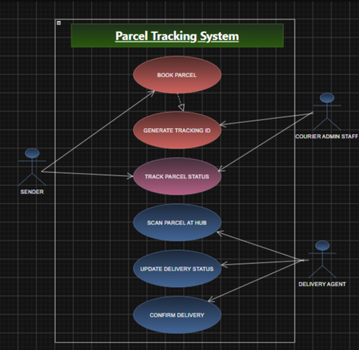

---

### 2. Class Diagram
Defines the object-oriented structure, class attributes, methods, and relationships (`Customer`, `Shipment`, `Courier`, `Payment`, `Warehouse`, `StatusLog`, `Admin`).

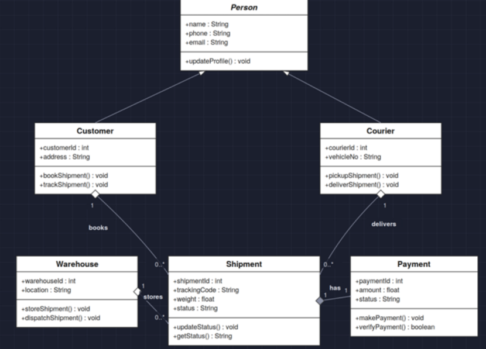

---

### 3. Sequence Diagram
Captures the chronological flow of messages for the parcel tracking workflow among the Customer, Tracking System, Parcel Database, and Delivery Agent.

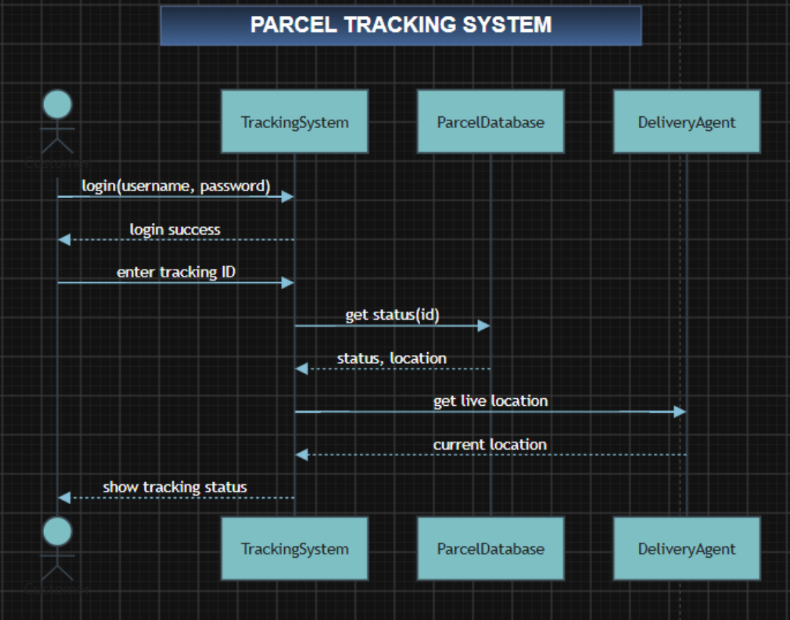

---

### 4. State Diagram (Shipment Lifecycle)
Tracks the finite state machine of a parcel from booking initiation to terminal states:

```
[OrderPlaced] ──> [PickupScheduled] ──> [PickedUp] ──> [InTransit]
                                                             │
                                                             ▼
[Delivered] <── [OutForDelivery] <── [AtSortingHub]
     ▲                 │
     │                 ▼
(OTP Valid)     [DeliveryFailed] ──(Max Retries Exceeded)──> [ReturnedToSender]
                       │
                       └──(Retry Scheduled)──> [OutForDelivery]

* Order can be [Cancelled] by customer from OrderPlaced or PickupScheduled states.
```

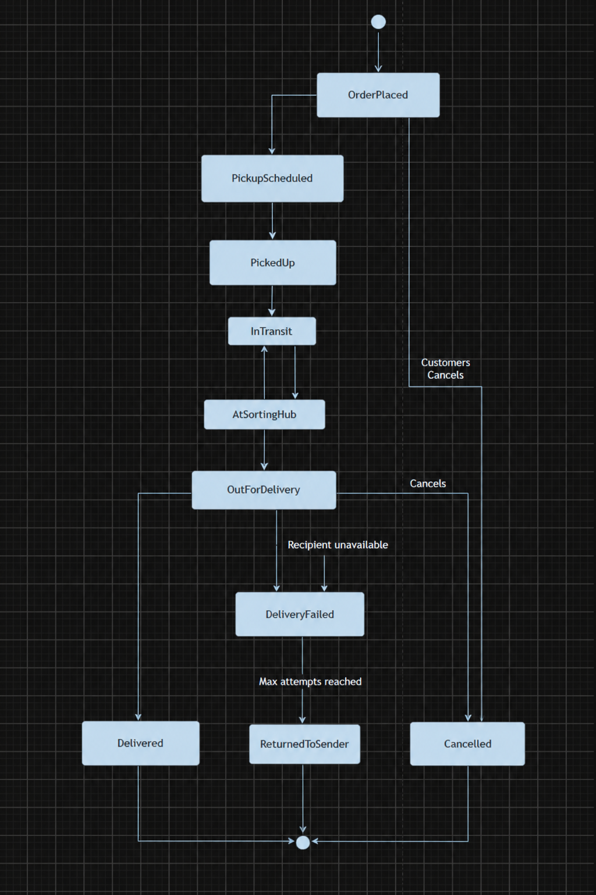

---

### 5. Activity Diagrams

#### A. Book Parcel Activity
User details validation, shipping charge computation, payment processing, and order creation.

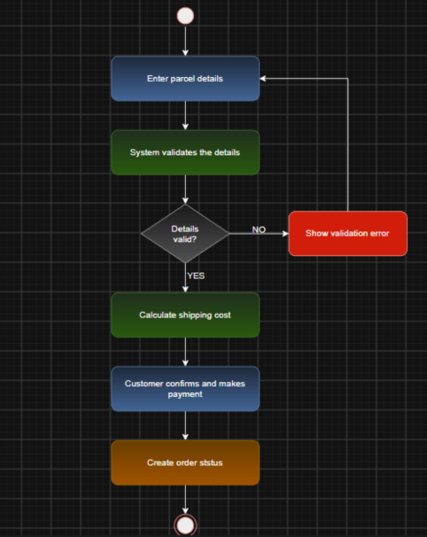

#### B. Track Parcel Status Activity
Tracking ID validation, database query, location retrieval, and status rendering.

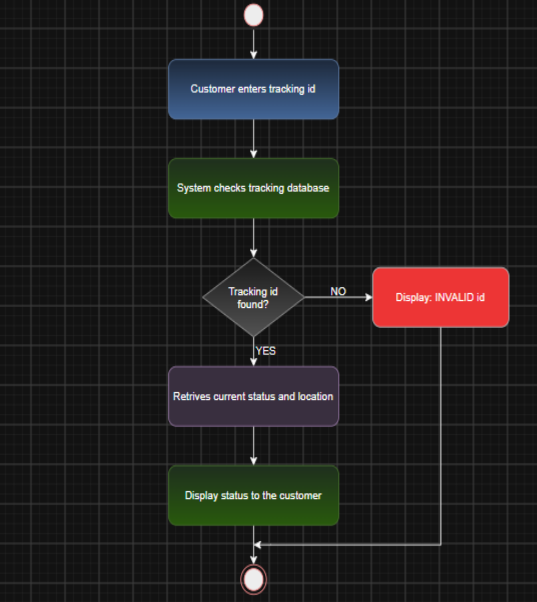

#### C. Confirm Delivery Activity
Agent arrival, barcode scanning, OTP verification with customer, and final delivery logging.

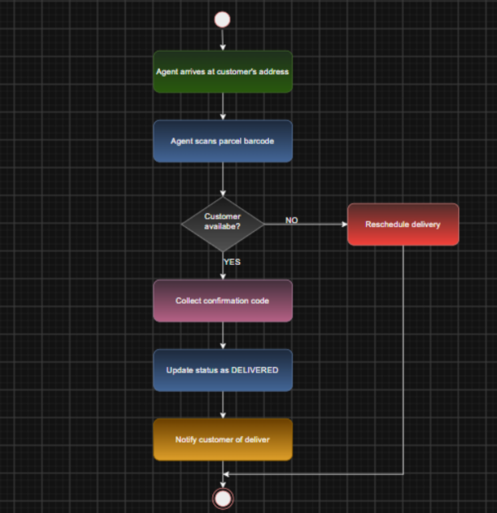

---

### 6. Component Diagram
Shows structural organization and dependencies among software components and defined interfaces (`ILogin`, `IBook`, `ITrack`, `INotify`).

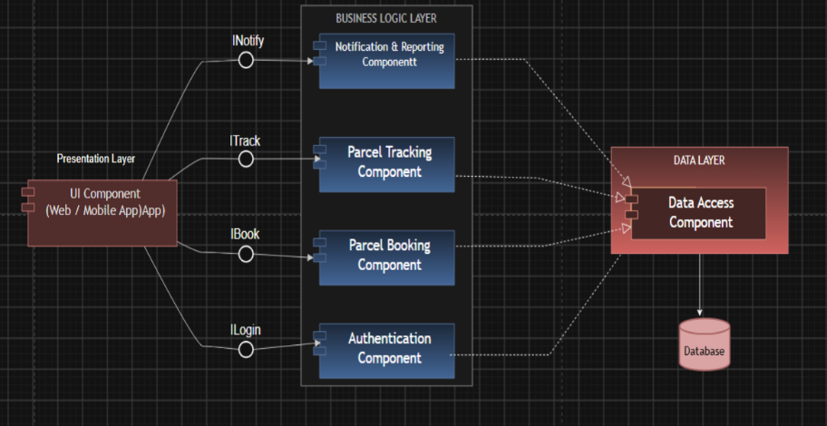

---

### 7. Deployment Diagram
Illustrates hardware nodes, web/application servers, database servers, and IoT client devices over secure HTTPS/MQTT protocols.

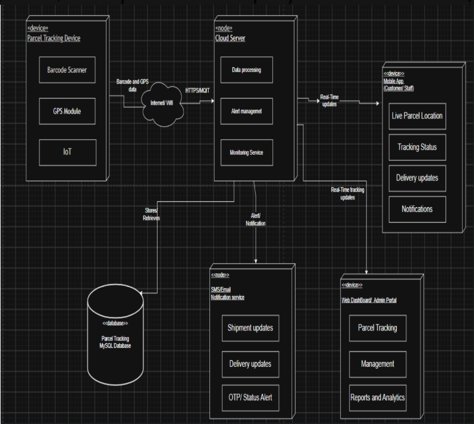

---

## 🗄️ Data Model & Entities

| Entity | Primary Key (PK) | Foreign Keys (FK) | Key Attributes |
| :--- | :--- | :--- | :--- |
| **Customer** | `Customer_ID` | — | Name, Email, Phone, Address, Password (hashed) |
| **Shipment / Parcel** | `Shipment_ID` | `Customer_ID`, `Warehouse_ID`, `Courier_ID` | Tracking_Code (Unique), Sender_Details, Receiver_Details, Weight, Status, Booking_Date |
| **Courier / Agent** | `Courier_ID` | — | Name, Phone, Email, Vehicle_No |
| **Delivery Agent** | `Agent_ID` | `Assigned_Parcel_ID` | Name, Contact |
| **Warehouse** | `Warehouse_ID` | — | Location, Capacity |
| **Payment** | `Payment_ID` | `Shipment_ID` | Amount, Payment_Date, Status (Paid/Pending) |
| **Status Log** | `Log_ID` | `Shipment_ID` | Status, Timestamp, Location |
| **Admin** | `Admin_ID` | — | Name, Login_Credentials |

---

## 📈 Project Estimation (COCOMO Model)

The project scope was estimated using the **Basic COCOMO (Constructive Cost Model)** in **Organic Mode**:

$$\text{Effort } (E) = a \cdot (\text{KLOC})^b = 2.4 \cdot (15)^{1.05}$$

$$\text{Development Time } (D) = c \cdot (E)^d = 2.5 \cdot (E)^{0.38}$$

$$\text{Average Team Size } (N) = \frac{E}{D}$$

### Organic Mode Parameters
- $a = 2.4$, $b = 1.05$
- $c = 2.5$, $d = 0.38$
- Estimated Size: **15.0 KLOC**

### Estimation Results
| Metric | Formula | Calculated Value |
| :--- | :--- | :--- |
| **Project Size** | Input | **15.0 KLOC** |
| **Effort** | $E = 2.4 \times (15.0)^{1.05}$ | **41.22 person-months** |
| **Development Time** | $D = 2.5 \times (41.22)^{0.38}$ | **10.27 months** |
| **Average Team Size** | $N = \frac{41.22}{10.27}$ | **~4 developers** |

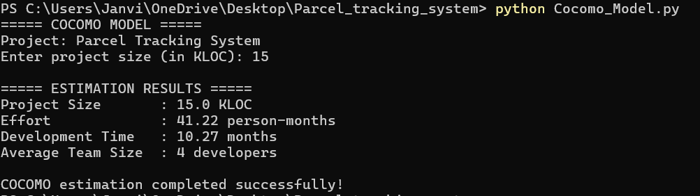

The estimation code is implemented in [`Cocomo_Model.py`](Cocomo_Model.py).

---

## 📅 Project Schedule (Gantt Chart)

The project timeline was planned over a 6-week software engineering lifecycle:

| ID | Task / Phase | Start Date | End Date |
| :---: | :--- | :---: | :---: |
| **1** | Requirement Analysis | 31-Aug-2026 | 03-Sep-2026 |
| **2** | System Design | 04-Sep-2026 | 07-Sep-2026 |
| **3** | Database Design | 08-Sep-2026 | 10-Sep-2026 |
| **4** | UI Development | 10-Sep-2026 | 14-Sep-2026 |
| **5** | Backend Development | 14-Sep-2026 | 19-Sep-2026 |
| **6** | GPS Tracking Module | 19-Sep-2026 | 25-Sep-2026 |
| **7** | Testing | 25-Sep-2026 | 26-Sep-2026 |
| **8** | Integration | 01-Oct-2026 | 06-Oct-2026 |
| **9** | Documentation | 04-Oct-2026 | 08-Oct-2026 |
| **10** | Final Deployment | 07-Oct-2026 | 10-Oct-2026 |

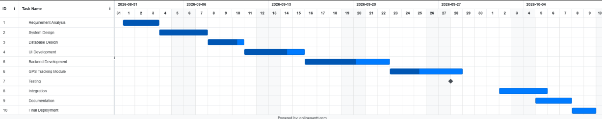

Detailed scheduling spreadsheet available in [`Gantt_Chart_Parcel_Tracking_System_.xlsx`](Gantt_Chart_Parcel_Tracking_System_.xlsx).

---

## 💻 Technology Stack

- **Frontend:** HTML5, CSS3, JavaScript
- **Backend:** Python (Django / Flask) / PHP / Java
- **Database:** MySQL (Relational Database Management System)
- **Protocols & Integrations:** HTTPS, MQTT (IoT messaging), RESTful APIs
- **Hardware Integration:** Barcode Scanner, GPS Module
- **Cost & Effort Estimation:** Python 3 ([`Cocomo_Model.py`](Cocomo_Model.py))
- **Documentation Standard:** IEEE 830-1998 SRS Specification ([`Courier_Parcel_Tracking_SRS..docx`](Courier_Parcel_Tracking_SRS..docx))

---

## 📁 Repository Structure

```text
Parcel_tracking_system/
├── README.md                                    # Comprehensive project documentation
├── Cocomo_Model.py                              # Python implementation of Basic COCOMO model
├── Cocomo_output.png                            # Terminal output of COCOMO calculation
├── Courier_Parcel_Tracking_SRS..docx            # Formal IEEE 830-1998 SRS document
├── Gantt_Chart_Parcel_Tracking_System_.xlsx      # Project timeline and task breakdown sheet
├── Gantt_chart_parcel_tracking_system.png       # Visual Gantt chart timeline
│
├── UML & System Diagrams:
│   ├── UseCase_parcel_tracking_system.png       # Use Case Diagram
│   ├── Class_diagram_Parcel_tracking_system.png # Class Diagram
│   ├── Sequence_diagram_Parcel_tracking_system.png # Sequence Diagram
│   ├── State_diagram_Parcel_tracking_system.png # Shipment Lifecycle State Diagram
│   ├── Activity_diagram_Book_Parcel.png         # Activity Diagram - Booking flow
│   ├── Activity_diagram_Track_parcel_status.png # Activity Diagram - Tracking flow
│   ├── Activity_diagram_Confirm_delivery.png    # Activity Diagram - Delivery flow
│   ├── Component_diagram_parcel_tracking_system.png # Component Diagram
│   └── Deployment_diagram_parcel_tracking_system.png # Deployment Diagram
```

---

## 🚀 Running the Estimation Script

To run the COCOMO estimation script locally:

```bash
# Clone the repository
git clone https://github.com/Janvithakre25/Parcel_tracking_system.git

# Navigate to project directory
cd Parcel_tracking_system

# Run COCOMO script
python Cocomo_Model.py
```

**Sample Input/Output:**
```text
===== COCOMO MODEL =====
Project: Parcel Tracking System
Enter project size (in KLOC): 15

===== ESTIMATION RESULTS =====
Project Size       : 15.0 KLOC
Effort             : 41.22 person-months
Development Time   : 10.27 months
Average Team Size  : 4 developers

COCOMO estimation completed successfully!
```

---

## 👩‍💻 Project Information

- **Author:** Janvi Thakre
- **Course:** Software Engineering & Project Management (SEPM)
- **Institution:** Ramdeobaba University, Nagpur
- **Standard:** IEEE 830-1998 Recommended Practice for Software Requirements Specifications
